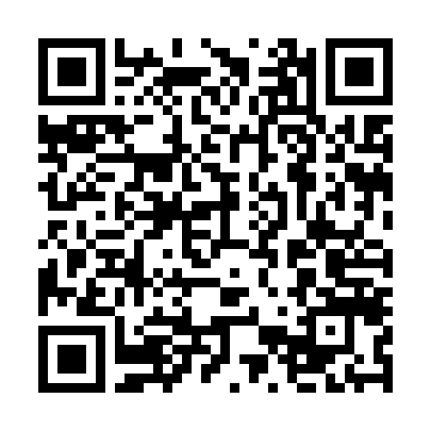

# Niceleyici Laboratuvarı

**Herkes için ayrı bir tanık mı, herkes için aynı tanık mı?**

MAT507 kitabının **Niceleyiciler: “Her” ve “Bazı” Üzerine Muhakeme** bölümüne eşlik eden öğrenci atölyesi.

**[Atölyeyi Google Colab’da aç →](https://colab.research.google.com/github/ibrahimguney/matematik-dusunme/blob/main/atolyeler/niceleyiciler/niceleyici_laboratuvari.ipynb)** · [Not defterini GitHub’da incele](niceleyici_laboratuvari.ipynb) · [Kitabı oku](../../kitap/MAT507_Matematiksel_Dusunme_ve_Muhakeme.pdf)

## Başlangıç

1. Colab bağlantısını açın; çalıştırmak ve kaydetmek için Google hesabınızla giriş yapmanız gerekebilir.
2. **Dosya → Drive'a bir kopya kaydet** seçin.
3. Tahmin alanlarını önce doldurun; ardından kod hücrelerini sırayla çalıştırın.
4. Kutuları değiştirerek deneyin; widget görünmezse 0/1 tablosunu düzenleyin.
5. Çıkış biletini kendi defterinizde tamamlayın. Teslim için öğretmeninizin belirlediği yöntemi kullanın.

**Süre:** 35–45 dakika. Python bilmek gerekmez. Öğrenci tarafında paket kurulumu ve haricî veri indirme yoktur; standart Colab ortamındaki IPython ve ipywidgets kullanılır.

## Araştırma durakları

- **Tahmin et:** Her öğrencinin bir soru çözmesi, ortak bir soru olduğu anlamına gelir mi?
- **Dene:** 4×4 öğrenci–soru tablosunu değiştir; tanıkları ve karşı örnekleri bul.
- **Gerekçelendir:** Ortak tanık neden kişiye göre seçilen tanıktan daha güçlü bir koşuldur?
- **Olumsuzla:** “Her öğrenci en az bir soru çözdü” ifadesini çürüt.
- **Sınırı fark et:** Sonlu bir kümede yanlış çıkan cümle doğal sayılarda doğru olabilir mi?
- **Üret:** Kendi ilişkini, evrenlerini ve gerekçeni yaz.

## Kare kod

Bu kod Colab'a doğrudan değil, **bu bölüm sayfasına** gider. Böylece kitabın basılı bağlantısını değiştirmeden atölye yönergeleri güncellenebilir. Depo ve bu klasörün yolu korunmalıdır. GitHub Pages etkinleştirmek gerekmez.

[PNG indir](../../kitap/kaynak/figs/atolye_niceleyiciler_qr.png) · [SVG indir](../../karekodlar/niceleyiciler.svg)

Kare kod hedefi: https://github.com/ibrahimguney/matematik-dusunme/tree/main/atolyeler/niceleyiciler

## Öğretmen için

[Uygulama rehberi ve değerlendirme ölçütleri](../../ogretmen/niceleyiciler.md). Öğrenci defterleri otomatik toplanmaz; atölye bir sunucuya yanıt göndermez. Öğrenci cevaplarını herkese açık depoya yüklemek gerekmez.
